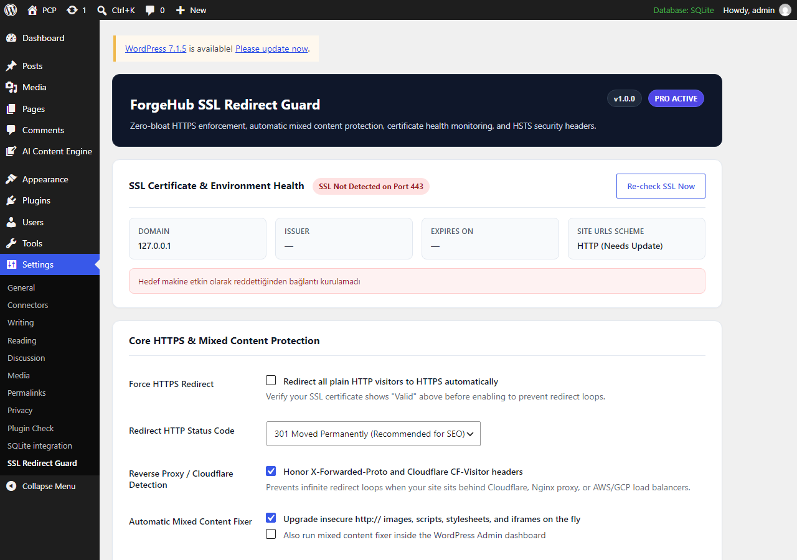

# ForgeHub SSL Redirect Guard

Zero-bloat HTTP to HTTPS 301 redirect enforcement, automatic mixed content fixer, live SSL certificate health monitoring, and HSTS security headers.

## Free vs Pro Comparison

| Feature | Free | Pro |
| :--- | :---: | :---: |
| HTTP to HTTPS 301 / 302 Redirect | ✅ | ✅ |
| Cloudflare & Reverse Proxy Loop Protection | ✅ | ✅ |
| Automatic Mixed Content Fixer (Frontend + Optional Admin) | ✅ | ✅ |
| Live SSL Certificate Health & Expiry Inspector | ✅ | ✅ |
| One-Click Site & Home URL HTTPS Switcher | ✅ | ✅ |
| Secure Cookie Flag Enforcement | ✅ | ✅ |
| Custom Excluded URL Paths (ACME Safe) | ✅ | ✅ |
| HSTS (`Strict-Transport-Security`) + `includeSubDomains` + `preload` | — | ✅ |
| CSP `upgrade-insecure-requests` & Security Headers | — | ✅ |
| Automated SSL Expiry Email Alerts (Daily Cron) | — | ✅ |
| Mixed Content Live Page Scanner | — | ✅ |

---

## 📸 Admin Preview

  

## Installation

1. Upload `forgehub-ssl-redirect` to `/wp-content/plugins/`.
2. Activate the plugin in **Admin > Plugins**.
3. Open **Settings > SSL Redirect Guard**, verify SSL health, and enable HTTPS redirect.

## Links

- Product Page: https://wpforgehub.com/product/ssl-redirect/
- Documentation: https://wpforgehub.com/docs/
- Support: [WPForgeHub Support Portal](https://wpforgehub.com/support/) & [GitHub Issues](https://github.com/WpForgeHub/forgehub-ssl-redirect/issues)
